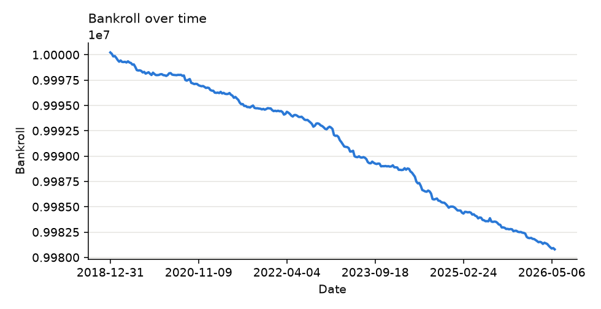
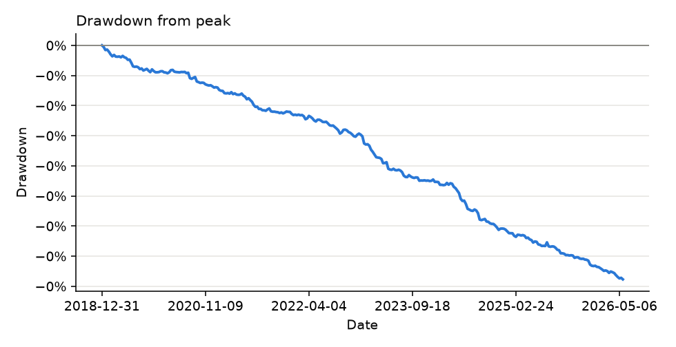
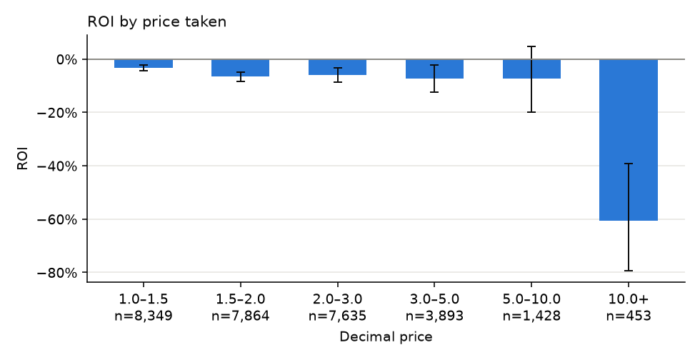
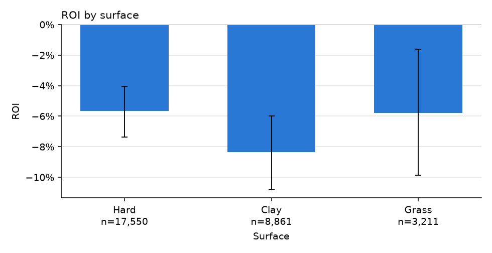
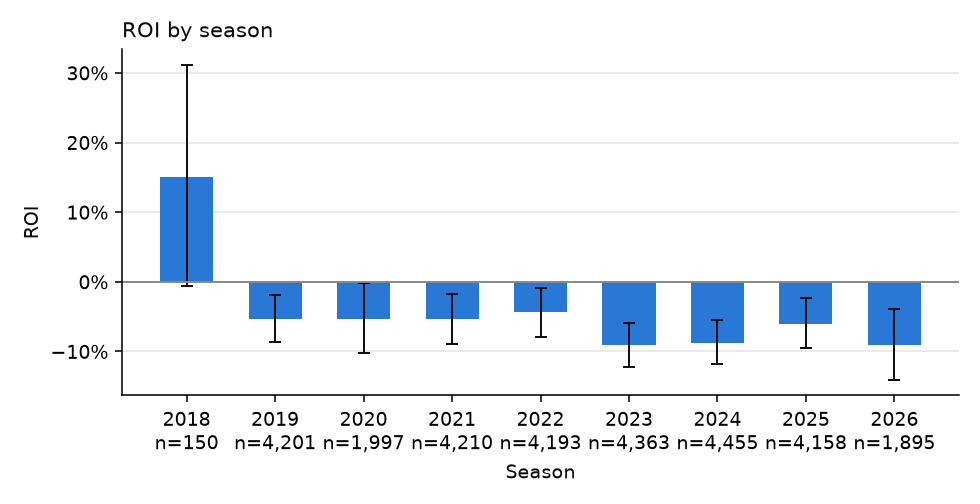
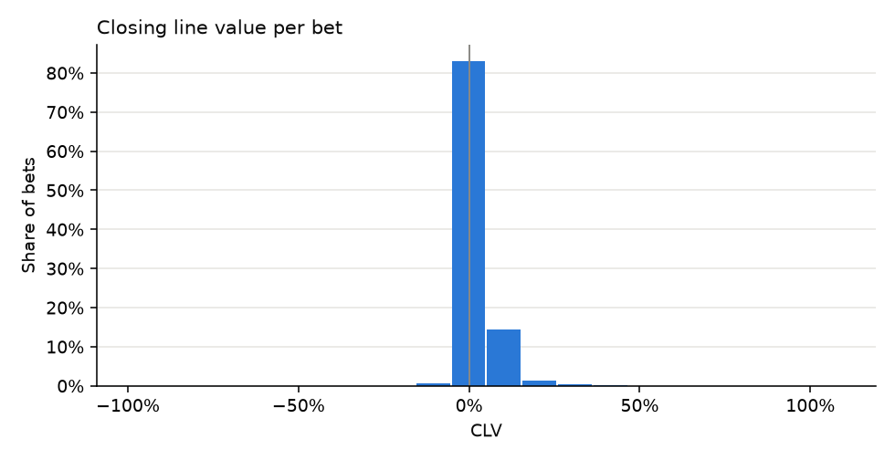
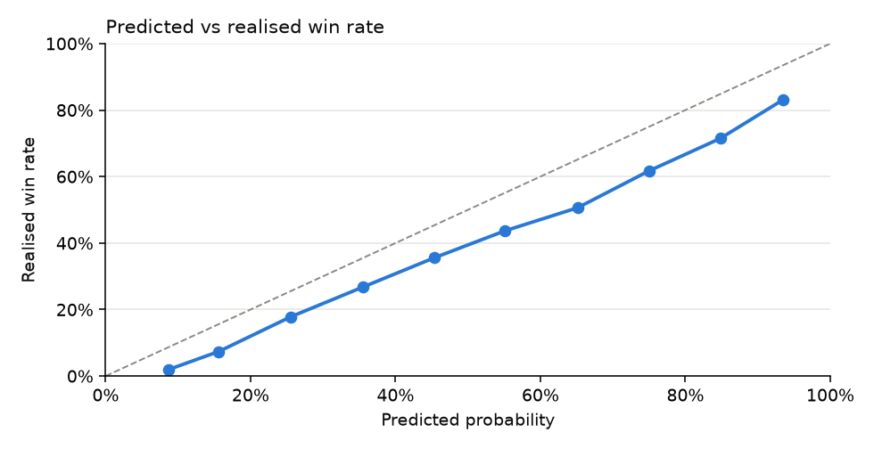

# S1 · Does EloValue show positive CLV when ROI is noisy?

## Hypothesis

Bets placed when Elo disagrees with the closing market by at least θ beat the closing price on average (CLV > 0), even though the ROI over the same bets cannot be distinguished from zero.

## Economic rationale

Closing prices are the sharpest estimate of true probability, so beating them is the cleanest evidence of edge; ROI over a few thousand bets at long odds has a confidence interval too wide to show it.

## Pre-registered metric and threshold

- **Metric:** CLV bootstrap 95% CI and ROI bootstrap 95% CI on the 2019+ holdout
- **Decision rule:** Supported iff the CLV CI lies entirely above 0 and the ROI CI contains 0.

## Sample discipline

- **In-sample (tuning allowed):** seasons <= 2018: pick θ from (0.02, 0.04, 0.06, 0.08, 0.1) with the highest CLV among grids with >= 300 bets
- **Out-of-sample (touched once):** seasons >= 2019, touched once, with the chosen θ

## Results

<!-- generated:results -->

> **In plain words:** We rate every player with Elo (a score that rises with wins and falls with losses) and bet whenever our rating likes a player clearly more than the bookmakers do. We then check whether those bets got better odds than the final pre-match odds, compared with simply betting at random. The better odds seen in the raw numbers turn out to come from the bookmaker we place bets with, not from the rating.

**Verdict: not supported** — EloValue's CLV does not exceed a random-bet control with the same fills: the positive raw CLV comes from the fill book's tighter prices, not from edge.

#### In-sample tuning grid

| θ | Bets | ROI | CLV |
|---|---|---|---|
| 0.02 | 53473 | -5.84% | +2.17% |
| 0.04 | 43871 | -5.90% | +2.11% |
| 0.06 | 35345 | -6.29% | +2.07% |
| 0.08 | 28001 | -6.17% | +2.06% |
| 0.1 | 22080 | -6.38% | +2.09% |

#### Holdout 2019+ (θ = 0.02)

| Bets | ROI | ROI 95% CI | CLV | CLV 95% CI | Control CLV (random_bet) |
|---|---|---|---|---|---|
| 29622 | -6.48% | -7.79% … -5.18% | +2.44% | +2.38% … +2.50% | +2.82% |

<!-- /generated -->
