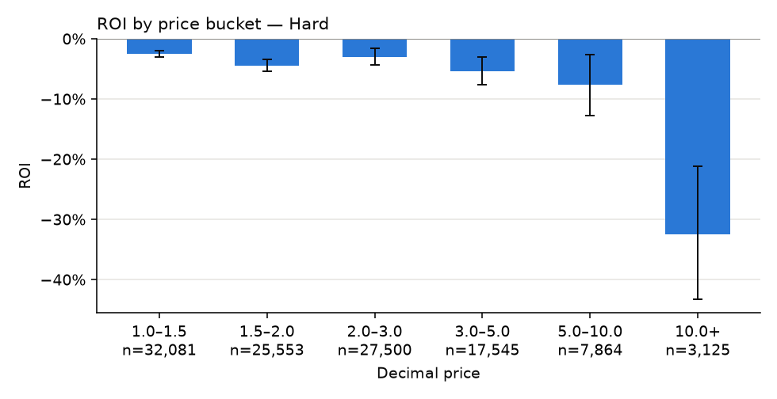
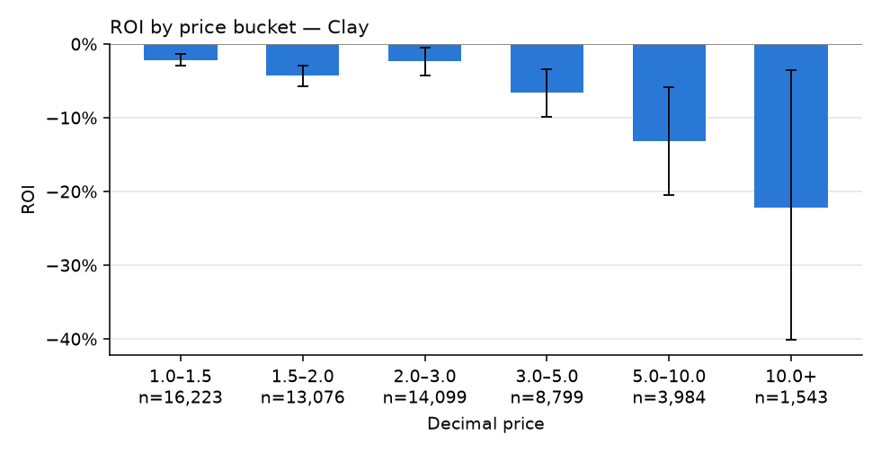
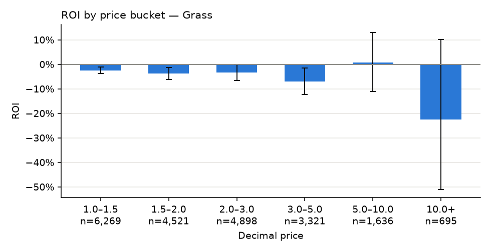

# S2 · Favourite–longshot bias by surface and price

## Hypothesis

Expected value declines as the price lengthens: on every surface the shortest bucket has a higher ROI than the longest, and no bucket's ROI interval lies entirely above zero.

## Economic rationale

Bettors overpay for longshots, so books can shade them harder; favourites are closer to fairly priced, though still net of the margin.

## Pre-registered metric and threshold

- **Metric:** ROI per surface x price bucket, with bootstrap 95% CI (flat stake)
- **Decision rule:** Supported iff shortest-bucket ROI > longest-bucket ROI on all 3 surfaces and no bucket with >= 100 bets has ROI CI low > 0.

## Sample discipline

- **In-sample (tuning allowed):** none — descriptive, nothing is tuned
- **Out-of-sample (touched once):** none — the whole odds-era sample

## Results

<!-- generated:results -->

**Verdict: supported** — Longshots lose more than favourites on every surface and no bucket is profitable.

#### ROI by surface and price bucket

| Surface | Price | Bets | ROI | ROI 95% CI |
|---|---|---|---|---|
| Hard | 1.0–1.5 | 32081 | -2.52% | -3.10% … -1.94% |
| Hard | 1.5–2.0 | 25553 | -4.50% | -5.42% … -3.49% |
| Hard | 2.0–3.0 | 27500 | -2.98% | -4.36% … -1.55% |
| Hard | 3.0–5.0 | 17545 | -5.36% | -7.67% … -2.97% |
| Hard | 5.0–10.0 | 7864 | -7.59% | -12.73% … -2.67% |
| Hard | 10.0+ | 3125 | -32.43% | -43.32% … -21.13% |
| Clay | 1.0–1.5 | 16223 | -2.17% | -2.92% … -1.34% |
| Clay | 1.5–2.0 | 13076 | -4.30% | -5.75% … -2.91% |
| Clay | 2.0–3.0 | 14099 | -2.34% | -4.33% … -0.47% |
| Clay | 3.0–5.0 | 8799 | -6.64% | -9.92% … -3.39% |
| Clay | 5.0–10.0 | 3984 | -13.20% | -20.49% … -5.91% |
| Clay | 10.0+ | 1543 | -22.19% | -40.17% … -3.59% |
| Grass | 1.0–1.5 | 6269 | -2.48% | -3.81% … -1.21% |
| Grass | 1.5–2.0 | 4521 | -3.79% | -6.29% … -1.36% |
| Grass | 2.0–3.0 | 4898 | -3.34% | -6.62% … -0.18% |
| Grass | 3.0–5.0 | 3321 | -7.03% | -12.34% … -1.43% |
| Grass | 5.0–10.0 | 1636 | +0.80% | -11.09% … +13.04% |
| Grass | 10.0+ | 695 | -22.57% | -51.13% … +10.18% |

<!-- /generated -->
