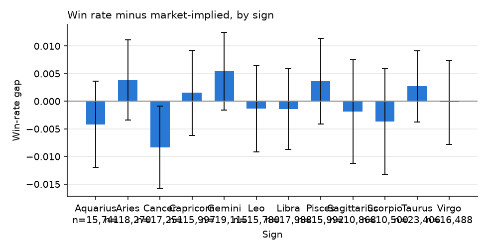

# S3 · Does a player's zodiac sign beat the market?

## Hypothesis

At least one zodiac sign, element or birth month wins more often than its no-vig market price implies.

## Economic rationale

None: the claim has no causal mechanism. It is the harness's null demonstrator — the expected verdict is that the correction rejects it.

## Pre-registered metric and threshold

- **Metric:** two-sided z-test of wins vs market-implied wins per cohort; Bonferroni and Benjamini–Hochberg corrected over all cohorts
- **Decision rule:** Supported iff any Bonferroni-corrected p < 0.05.

## Sample discipline

- **In-sample (tuning allowed):** none — nothing is fit
- **Out-of-sample (touched once):** none — the whole odds-era sample

## Results

<!-- generated:results -->

> **In plain words:** We check whether players born under a given star sign, element or month win more often than the odds predict. There is no reason this should work, so it shows how often pure chance looks like a pattern when many groups are tested.

**Verdict: not supported** — 1 of 28 cohorts have raw p < 0.05 (about 1.4 expected by chance); none survives correction (smallest Bonferroni p = 0.790).

#### 28 cohort tests against the market

| Dimension | Cohort | Observations | Win rate | Market-implied | p | p (Bonf.) | q (BH) |
|---|---|---|---|---|---|---|---|
| zodiac_sign | Aquarius | 15741 | 46.82% | 47.24% | 0.291 | 1.000 | 0.879 |
| zodiac_sign | Aries | 18270 | 49.97% | 49.58% | 0.297 | 1.000 | 0.879 |
| zodiac_sign | Cancer | 17251 | 47.48% | 48.32% | 0.028 | 0.790 | 0.790 |
| zodiac_sign | Capricorn | 15997 | 49.78% | 49.63% | 0.701 | 1.000 | 0.879 |
| zodiac_sign | Gemini | 19115 | 53.96% | 53.42% | 0.132 | 1.000 | 0.879 |
| zodiac_sign | Leo | 15780 | 50.77% | 50.91% | 0.732 | 1.000 | 0.879 |
| zodiac_sign | Libra | 17988 | 50.80% | 50.95% | 0.697 | 1.000 | 0.879 |
| zodiac_sign | Pisces | 15992 | 50.64% | 50.27% | 0.354 | 1.000 | 0.879 |
| zodiac_sign | Sagittarius | 10868 | 45.91% | 46.09% | 0.700 | 1.000 | 0.879 |
| zodiac_sign | Scorpio | 10500 | 48.46% | 48.83% | 0.448 | 1.000 | 0.879 |
| zodiac_sign | Taurus | 23406 | 51.21% | 50.94% | 0.411 | 1.000 | 0.879 |
| zodiac_sign | Virgo | 16488 | 51.06% | 51.08% | 0.959 | 1.000 | 0.995 |
| zodiac_element | air | 52844 | 50.76% | 50.74% | 0.920 | 1.000 | 0.991 |
| zodiac_element | earth | 55891 | 50.76% | 50.61% | 0.478 | 1.000 | 0.879 |
| zodiac_element | fire | 44918 | 49.27% | 49.20% | 0.785 | 1.000 | 0.879 |
| zodiac_element | water | 43743 | 48.87% | 49.15% | 0.235 | 1.000 | 0.879 |
| birth_month | 1 | 15436 | 46.22% | 46.48% | 0.525 | 1.000 | 0.879 |
| birth_month | 10 | 13444 | 48.80% | 49.30% | 0.241 | 1.000 | 0.879 |
| birth_month | 11 | 11965 | 47.59% | 47.81% | 0.635 | 1.000 | 0.879 |
| birth_month | 12 | 14671 | 49.72% | 49.60% | 0.762 | 1.000 | 0.879 |
| birth_month | 2 | 16961 | 49.52% | 49.36% | 0.671 | 1.000 | 0.879 |
| birth_month | 3 | 16417 | 49.92% | 49.42% | 0.196 | 1.000 | 0.879 |
| birth_month | 4 | 18141 | 51.33% | 51.12% | 0.570 | 1.000 | 0.879 |
| birth_month | 5 | 23617 | 51.10% | 50.90% | 0.526 | 1.000 | 0.879 |
| birth_month | 6 | 17657 | 52.49% | 52.49% | 0.995 | 1.000 | 0.995 |
| birth_month | 7 | 14787 | 48.21% | 48.67% | 0.269 | 1.000 | 0.879 |
| birth_month | 8 | 16790 | 51.06% | 51.30% | 0.540 | 1.000 | 0.879 |
| birth_month | 9 | 17510 | 51.79% | 51.66% | 0.715 | 1.000 | 0.879 |

<!-- /generated -->
