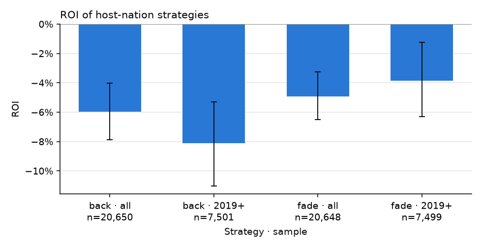

# S4 · Does backing or fading home-nation players make money?

## Hypothesis

Players from the tournament's host country win at a rate different from their no-vig market price, and backing or fading them earns a positive ROI.

## Economic rationale

Home crowds, local-media attention and bettors backing their compatriots could push home players' prices below fair — or crowd support could genuinely help them and the market under-price it. Either direction is testable.

## Pre-registered metric and threshold

- **Metric:** home-player win rate vs market-implied (z-test); ROI and CLV bootstrap 95% CIs of back_home_nation and fade_home_nation
- **Decision rule:** Supported iff the cohort p < 0.05 and a strategy's 2019+ ROI CI lies entirely above 0 with >= 100 bets.

## Sample discipline

- **In-sample (tuning allowed):** none — nothing is tuned
- **Out-of-sample (touched once):** seasons >= 2019, reported alongside the full sample

## Results

<!-- generated:results -->

**Verdict: not supported** — Home players' win rate is indistinguishable from their market price (p = 0.759) and neither strategy beats the margin on the holdout.

#### Home player vs market (matches with exactly one home player)

| Observations | Win rate | Market-implied | Gap | p |
|---|---|---|---|---|
| 20651 | 46.64% | 46.75% | -0.11% | 0.759 |

#### Trading the home-nation effect (flat stake; CLV is only meaningful relative to the control — fills at Pinnacle vs an Avg close give every bet positive CLV)

| Strategy | Sample | Bets | ROI | ROI 95% CI | CLV (95% CI) |
|---|---|---|---|---|---|
| back_home_nation | all seasons | 20650 | -5.97% | -7.87% … -4.04% | +3.30% (+3.18% … +3.41%) |
| back_home_nation | 2019+ holdout | 7501 | -8.10% | -11.02% … -5.30% | +3.28% (+3.12% … +3.45%) |
| fade_home_nation | all seasons | 20648 | -4.93% | -6.50% … -3.27% | +2.56% (+2.46% … +2.67%) |
| fade_home_nation | 2019+ holdout | 7499 | -3.86% | -6.31% … -1.24% | +2.52% (+2.40% … +2.64%) |
| random_bet (control) | all seasons | 98699 | -4.69% |  | +2.81% |

<!-- /generated -->
